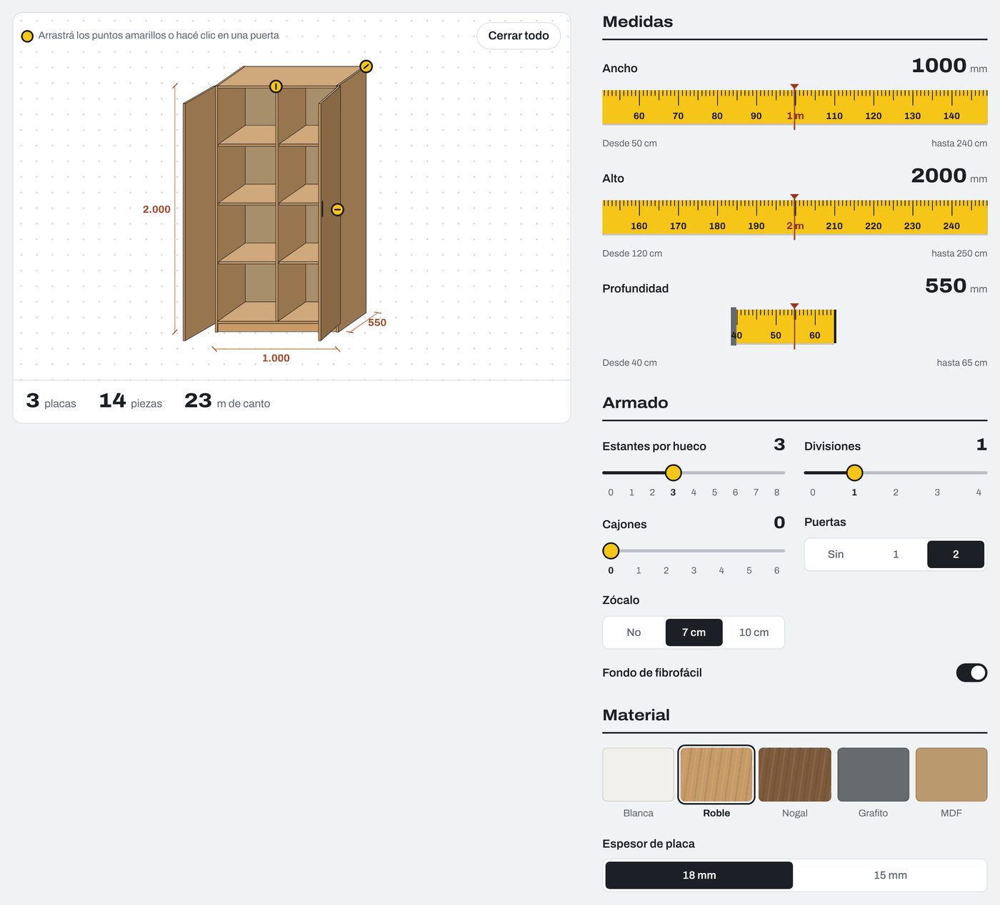
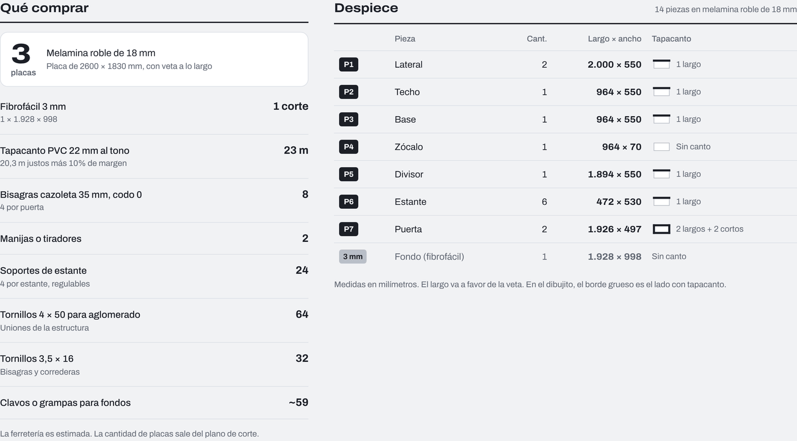
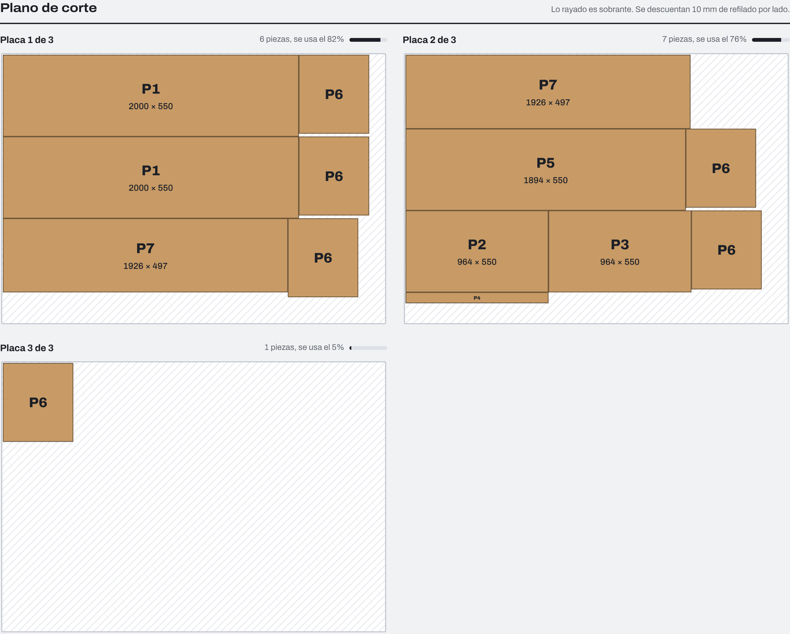
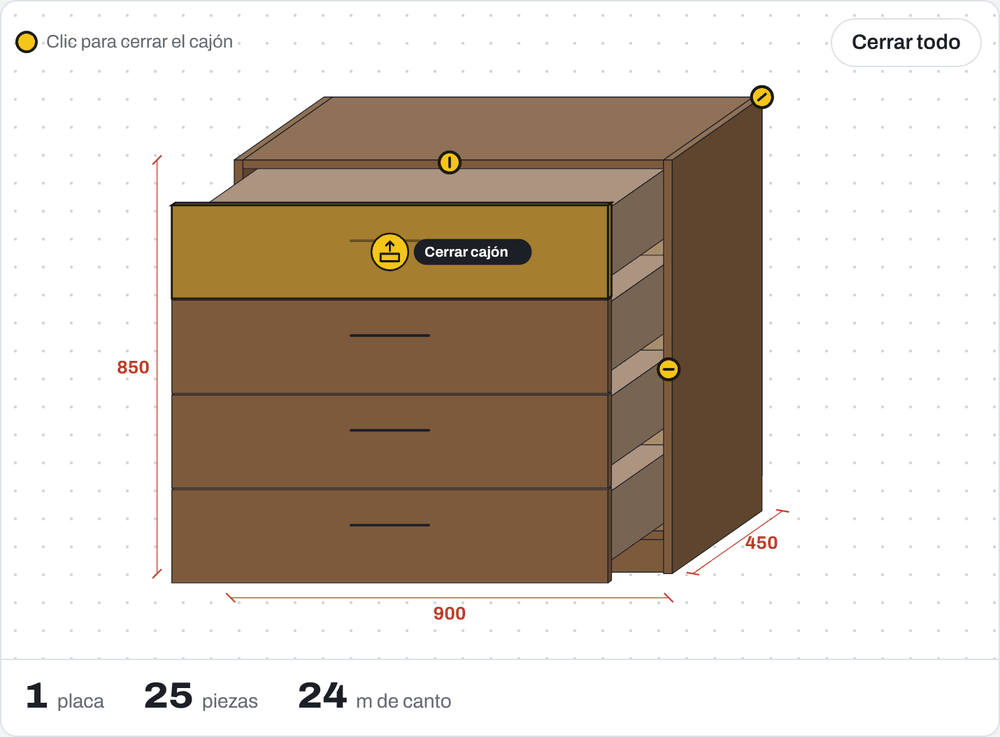
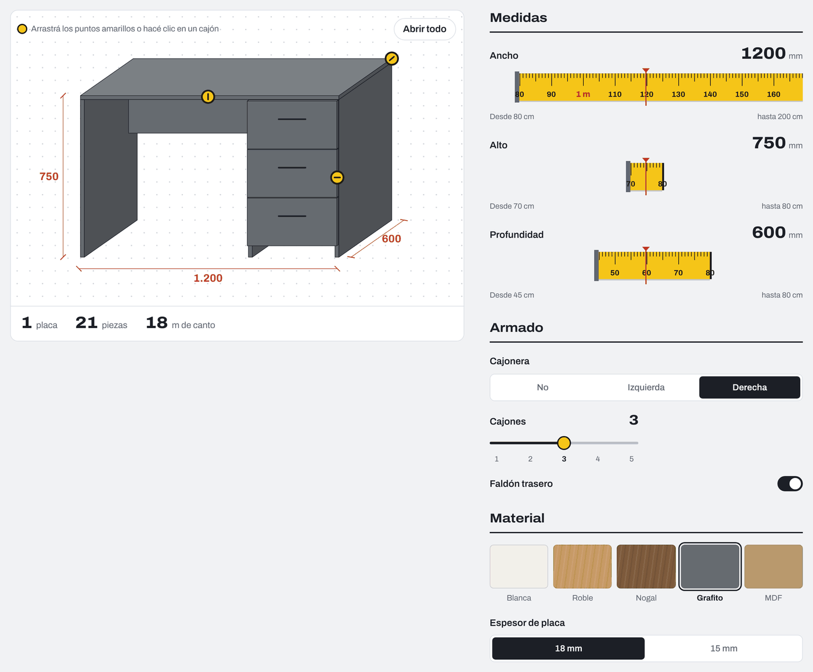
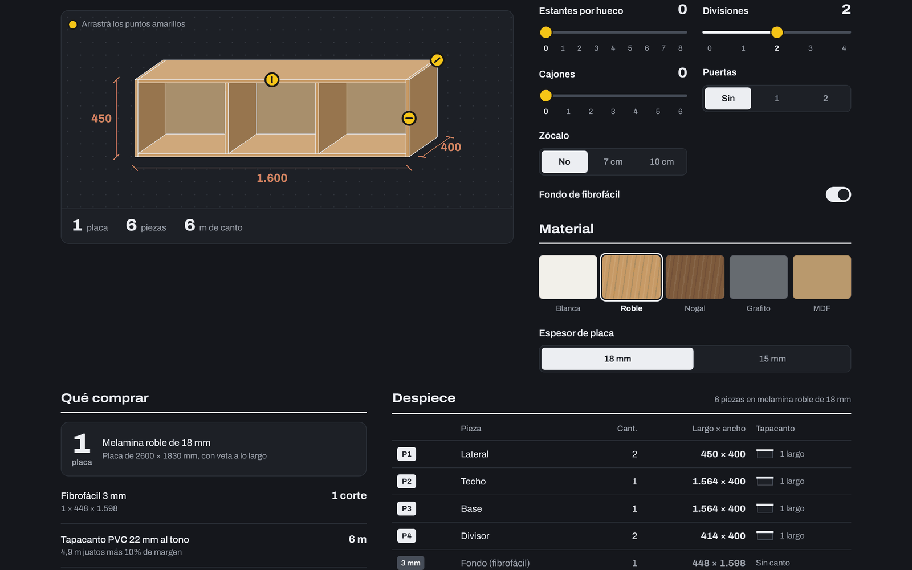
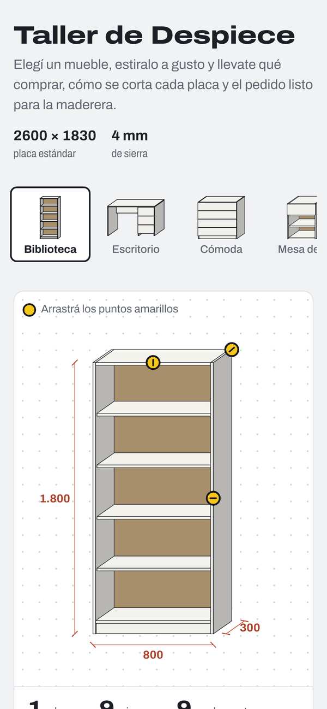

<h1 align="center">Taller de Despiece</h1>

<p align="center">
  Design a custom melamine cabinet in the browser and get the exact cut list, sheet cutting plan and shopping list for the lumber yard.
</p>

<p align="center">
  <a href="https://taller-despiece.jaycodes.workers.dev"><strong>Live demo</strong></a> ·
  <a href="README.es.md">Leer en español</a> ·
  <a href="CHANGELOG.md">Changelog</a>
</p>

<p align="center">
  
  
  
  
  
  
</p>

<p align="center">
  
</p>

## Why I built it

Building custom furniture has a tedious, error-prone step: turning a sketch into a list of parts. Do the side panels run full height or sit between the top and bottom? How much do you subtract for board thickness? Which edges get banding? Tools like SketchUp with plugins or Polyboard solve this, but they are heavy for someone who just wants a bookcase.

Taller de Despiece does that math live. You pick a piece of furniture, stretch it to size, and the app shows how many sheets to buy, how each sheet is cut and what hardware you need. The UI is in Spanish because it targets lumber yards and DIY builders in Argentina.

## Features

| | |
|---|---|
| **11 parametric furniture types** | Bookcase, desk, chest of drawers, nightstand, wardrobe, TV stand, base cabinet, wall cabinet, shoe cabinet, coffee table and bench. |
| **Tape-measure controls** | Drag a tape measure, drag the yellow handles on the drawing, or type the exact size in millimetres. |
| **Interior layout** | Shelves, dividers, drawers, doors, plinth, back panel, desk drawer unit and modesty panel. |
| **Interactive 3D drawing** | Hover a door or drawer to highlight it, click to open it with an animation, or open everything at once. |
| **Cut list** | Every part with its size, quantity and which sides need edge banding, shown as a small diagram. |
| **Cutting plan** | Parts laid out on standard 2600 × 1830 mm sheets, with saw kerf, trim and grain direction. |
| **Shopping list** | Sheets, back panel, metres of edge banding, hinges, drawer slides, shelf pins and screws. |
| **Woodworking warnings** | Shelves that will sag, doors that are too wide, missing back or modesty panel, tall units that need wall anchoring. |
| **Ready-to-send order** | One click copies the full cut list as text for WhatsApp or email. |
| **Light and dark themes** | Follows the system setting. Works on phones, with the keyboard and with reduced motion. |

<p align="center">
  
</p>

<table>
  <tr>
    <td width="50%"><br><sub>Shopping list and cut list with edge banding per side.</sub></td>
    <td width="50%"><br><sub>Guillotine cutting plan. Hatched areas are offcuts.</sub></td>
  </tr>
  <tr>
    <td><br><sub>Drawers slide out and highlight on hover.</sub></td>
    <td><br><sub>Desk with drawer unit and modesty panel.</sub></td>
  </tr>
</table>

<table>
  <tr>
    <td width="62%"><br><sub>Dark theme.</sub></td>
    <td width="19%"></td>
    <td width="19%"></td>
  </tr>
</table>

## Technical highlights

**Parametric furniture model.** Each furniture type is a generator function. From width, height, depth, board thickness and options it produces two things at once: the list of parts for the cut list and the 3D boxes for the drawing, so both always agree. It handles joints, plinths, drawer boxes and picks the drawer slide length from the available depth.

**Cutting optimizer.** A 2D bin-packing heuristic restricted to guillotine cuts, which is how panel saws work. Parts are sorted by longest side and placed with a best-area-fit rule, accounting for saw kerf and sheet trim. Rotation is allowed unless the material has grain.

**Hand-built 3D renderer.** No WebGL or 3D library. Boxes are projected with an oblique projection into SVG. Draw order comes from a topological sort over pairwise depth comparisons (painter's algorithm), and faces are culled by the sign of their projected area. Doors are prisms rotated around their hinge, and the viewport tweens while they open so nothing jumps.

**Custom tape-measure slider.** Built on Canvas with device-pixel-ratio scaling. It supports pointer drag with inertia, horizontal wheel, and keyboard (arrows, Shift, Page Up/Down, Home/End). It exposes `role="slider"` with live ARIA values.

**Design system.** Color and type tokens with light and dark palettes, a responsive grid that stacks on phones, `prefers-reduced-motion` support and visible keyboard focus. The last design is saved in `localStorage`.

**No build step.** About 2,500 lines of vanilla JavaScript and CSS, split by responsibility, deployed as static assets on Cloudflare Workers.

## Project structure

```
public/
├── index.html          Markup and metadata (Open Graph, favicon)
├── css/styles.css      Design tokens, layout and components
└── js/
    ├── config.js       Sheet sizes, materials, furniture catalog, state
    ├── model.js        Parametric furniture generators
    ├── render3d.js     Oblique projection renderer, doors and drawers
    ├── cutting.js      Guillotine bin packing and sheet drawings
    ├── tape.js         Tape-measure slider component
    ├── render.js       Cut list, shopping list, warnings, order text
    ├── controls.js     Controls, catalog and material pickers
    ├── interactions.js Door and drawer hover, click and keyboard
    └── main.js         Drag handles, copy order, app start
docs/                   Screenshots and demo GIFs for this README
wrangler.jsonc          Cloudflare Workers configuration
```

## Run it locally

Open `public/index.html` in a browser, or run it with the Workers dev server:

```bash
npx wrangler dev
```

## Deploy

```bash
npx wrangler login
npx wrangler deploy
```

## Roadmap

Upcoming updates. Each one moves to the [changelog](CHANGELOG.md) when it ships.

- [ ] Export the cut list and cutting plan as a PDF
- [ ] Price estimate from an editable price list
- [ ] Shareable links that open a saved design
- [ ] Multi-section units (for example, a two-section wardrobe)
- [ ] Inset drawer fronts and configurable joinery
- [ ] Unit tests for the furniture model and the cutting optimizer
- [ ] React and react-three-fiber version with a real 3D view

## Limitations

The cut list assumes one assembly method: full-height side panels, top and bottom between the sides, and overlay doors. The cutting plan is a heuristic, so a lumber yard's optimizer may use one sheet fewer. Hardware quantities are estimates. Always confirm measurements before cutting.

## Author

Designed and developed by **Juan Cruz (Jay)**, frontend developer based in Mar del Plata, Argentina.
<!-- Agregá tus links: LinkedIn, portfolio, email -->

© 2026 Juan Cruz. All rights reserved.
